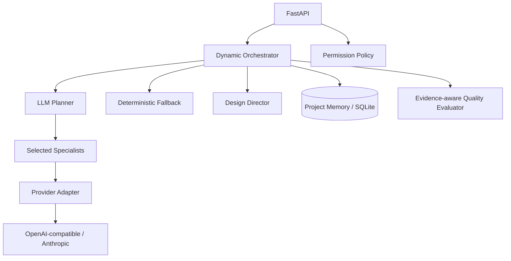

# Design Intelligence System

A standalone, provider-backed design intelligence foundation for improving web, desktop, and mobile products. DIS coordinates specialist design capabilities, maintains project-scoped memory, applies permission gates, and evaluates evidence against a quality rubric. It has no dependency on KubeDock or any specific product.

## Current capabilities

- Design Director and six specialist roles: creative, UX, visual design, design systems, frontend planning, and visual QA.
- Optional LLM-backed specialist analysis and dynamic specialist selection.
- OpenAI-compatible provider support (OpenAI, Groq, Gemini, Mistral, OpenRouter, and compatible endpoints) plus Anthropic Messages API.
- Deterministic fallback when no provider is configured or a provider request fails.
- Structured JSON response parsing and Pydantic validation.
- Project-scoped SQLite memory, permission policy, quality rubric, and FastAPI API.
- Provider status endpoint exposes configuration metadata only; API keys are never returned.

> **Capability boundary:** DIS can inspect GitHub repositories read-only, inspect deployed public web URLs in Chromium, use configured multimodal models to interpret screenshots, optionally crawl a bounded set of same-origin routes, prepare constrained frontend patches, and create a GitHub pull request only after explicit approval. It does not yet execute a repository checkout or build an arbitrary repository in a managed preview sandbox. Native desktop/mobile app automation and authenticated route journeys are not currently supported.

## Architecture



## Quick start

```bash
python -m venv .venv
source .venv/bin/activate  # Windows: .venv\Scripts\activate
pip install -e '.[dev]'
cp .env.example .env
uvicorn app.main:app --reload
```

DIS works without an API key in deterministic mode. To enable model-backed reasoning, edit `.env`:

```dotenv
DIS_LLM_PROVIDER=openai
DIS_LLM_API_KEY=your_api_key
DIS_LLM_MODEL=gpt-4o-mini
```

Supported provider values:
- `openai` — OpenAI API (default base URL: `https://api.openai.com/v1`)
- `anthropic` — Anthropic Messages API
- `groq`, `gemini`, `mistral`, `openrouter`, `openai-compatible` — OpenAI-compatible chat completions API

For compatible providers, set `DIS_LLM_BASE_URL` to the provider's OpenAI-compatible API base URL. Example for Groq:

```dotenv
DIS_LLM_PROVIDER=groq
DIS_LLM_BASE_URL=https://api.groq.com/openai/v1
DIS_LLM_API_KEY=your_api_key
DIS_LLM_MODEL=your-model-id
```

Keep `.env` out of version control. Never place API keys in source code, requests, or logs.

## Read-only GitHub repository inspection

DIS can now inspect a GitHub repository without cloning it or executing its code. The first adapter is intentionally read-only and framework-agnostic.

- Public repositories work without a GitHub token, subject to GitHub's anonymous API rate limit.
- For private repositories or higher API limits, set `DIS_GITHUB_TOKEN` in the server environment using a least-privilege token with repository Contents: read access.
- If a GitHub token or LLM API key is configured, also set `DIS_REPOSITORY_INSPECTION_API_KEY`. Requests must then include `X-DIS-API-Key`; the endpoint fails closed rather than exposing a configured GitHub token or allowing unauthenticated LLM usage.
- DIS inventories the repository tree, detects common stacks and framework signals, identifies likely entry points/routes/components/styles/design-system files, and reports declared test/lint/build commands.
- It samples a bounded number of files and limits bytes read. Likely embedded credentials are redacted before sampled text is sent to the configured LLM.
- It never executes project code, installs dependencies, runs tests, or claims visual verification. The report includes limitations and explicit “not executed” labels.
- The endpoint accepts `owner/name` or a `https://github.com/owner/name` URL. An optional `ref` selects a branch, tag, or commit.

Example:

```bash
curl -X POST http://127.0.0.1:8000/api/v1/repositories/inspect \
  -H 'Content-Type: application/json' \
  -H 'X-DIS-API-Key: your_shared_key' \
  -d '{"repository":"HareeshGT/KubeDock","include_file_samples":true}'
```

The response contains detected stacks/frameworks, entry points, route/page paths, component/style paths, design-system evidence, declared test commands, sampled-file evidence, an architecture summary, and limitations. It does not return source file contents.

## Browser-based visual inspection

The visual inspector accepts a public application URL and opens it in a headless Chromium browser at desktop (1440×1000), tablet (768×1024), and mobile (390×844) viewports. It returns viewport screenshots, page metadata, responsive overflow checks, and basic accessibility signals for image alternatives, accessible button/link names, form labels, and heading hierarchy.

- API: `POST /api/v1/visual/inspect` with JSON `{"url":"https://example.com","capture_screenshots":true,"analyze_with_vision":true}` to opt in to sending screenshots to the configured provider.
- Include `X-DIS-API-Key` when `DIS_REPOSITORY_INSPECTION_API_KEY` is configured.
- The target must be publicly reachable over HTTP(S). Localhost, private, loopback, link-local, and reserved IP targets are blocked, including redirects and browser subrequests.
- Browser inspection is read-only: it does not log in, submit forms, click controls, or modify the target.
- Screenshots are returned as base64 JPEGs in the response and are not persisted by the server.
- When the user explicitly enables AI screenshot analysis, screenshots are sent to the configured vision-capable provider for observations about visual hierarchy, spacing, typography, color and component consistency. Optional route exploration follows same-origin anchor links only, with a configurable hard limit. The score is heuristic, not a WCAG certification or objective design-quality guarantee.

## Browser dashboard

DIS includes a browser-based workspace served by the FastAPI application:

- Open `http://127.0.0.1:8000/` for the dashboard.
- **Overview** shows API health, provider mode, and recent inspections.
- **Repository inspector** accepts a GitHub URL or `owner/name`, with an optional branch/tag/commit ref.
- **Visual inspection** opens a public web URL in Chromium, captures desktop/tablet/mobile screenshots, optionally explores same-origin routes, and displays deterministic and multimodal design findings.\n- **Visual comparison** compares two deployed versions and shows screenshot change metrics plus resolved/new findings.\n- **UI improvement proposal** generates a bounded frontend patch for selected GitHub files, displays the diff, and opens a PR only after explicit approval.
- **Architecture report** displays detected stacks/frameworks, entry points, routes, components/styles, design-system signals, declared commands, sampled file evidence, and limitations.
- **Inspection history** is stored in the current browser's local storage. It can be cleared from the History page.
- If the server requires `DIS_REPOSITORY_INSPECTION_API_KEY`, enter that shared key in dashboard settings. It is stored in session storage for the current browser tab only. Do not enter a GitHub personal access token in the browser; configure `DIS_GITHUB_TOKEN` on the server.

The dashboard and API are served from the same origin; no separate frontend build or Node.js installation is required.

## Docker

Copy the example environment file, configure optional provider/GitHub credentials, and start DIS:

```bash
cp .env.example .env
# Edit .env; set DIS_REPOSITORY_INSPECTION_API_KEY when using an LLM key or GitHub token.
docker compose up --build -d
```

Then open `http://localhost:8000/`. Compose persists SQLite project memory in the named Docker volume `dis-data`.

Useful commands:

```bash
docker compose logs -f dis
docker compose ps
docker compose down
```

To build and run without Compose:

```bash
docker build -t design-intelligence-system .
docker run --rm -p 8000:8000 --env-file .env -v dis-data:/data design-intelligence-system
```

The container runs as a non-root user, includes a health check, and stores SQLite under `/data`. Keep `.env` private and never bake secrets into the Docker image.

## API

- `GET /` — browser dashboard
- `GET /health` — service health
- `GET /api/v1/agents` — registered roles
- `GET /api/v1/provider` — safe provider configuration status (never returns the key)
- `POST /api/v1/design/runs` — dynamically select specialists and orchestrate a design brief
- `POST /api/v1/visual/inspect` — capture and audit a public web page at three viewport sizes\n- `POST /api/v1/visual/compare` — compare before/after screenshots and deterministic findings\n- `POST /api/v1/improvements/propose` — generate a signed, reviewable frontend patch proposal\n- `POST /api/v1/improvements/apply` — create a PR from an approved proposal
- `POST /api/v1/permissions/evaluate` — evaluate an action against autonomy policy

Example:

```bash
curl -X POST http://127.0.0.1:8000/api/v1/design/runs \
  -H 'Content-Type: application/json' \
  -d '{"brief":"Design a premium analytics dashboard","constraints":["WCAG AA","mobile first"]}'
```

## Development and tests

```bash
pip install -e '.[dev]'
pytest -q
ruff check . --select E4,E7,E9,F
```

## Autonomy and safety

Routine analysis and design planning are autonomous. Destructive, external, publishing, deployment, permission-changing, and merge actions require explicit approval. Secret exfiltration and disabling security controls are prohibited. Provider errors fall back to deterministic analysis rather than taking down the API. Provider output is treated as untrusted data and is constrained to structured result fields. The permission policy is not a substitute for authorization checks in future execution adapters.

## Roadmap

1. **Foundation:** registry, orchestration, project memory, permission policy, quality rubric, API.
2. **Provider-backed reasoning (current):** configurable provider adapter, dynamic specialist selection, structured outputs, deterministic fallback.
3. **Product adapters (in progress):** GitHub repository discovery is available in read-only mode; deepen framework-aware context and design-system ingestion.
4. **Controlled execution:** patch proposals, sandboxed commands, approval workflow, browser automation.
5. **Visual feedback loop:** viewport screenshots, visual issue detection, repair proposals, regression comparison.
6. **Learning and operations:** reference library, project design memory, run tracing, observability, evaluation datasets.
