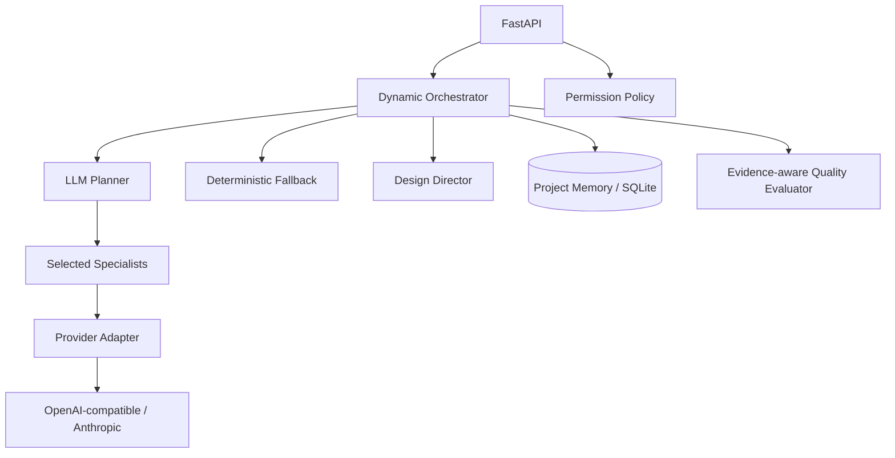

# Design Intelligence System

A standalone, provider-backed design intelligence foundation for improving web, desktop, and mobile products. DIS coordinates specialist design capabilities, maintains project-scoped memory, applies permission gates, and evaluates evidence against a quality rubric. It has no dependency on KubeDock or any specific product.

## Current capabilities

- Design Director and six specialist roles: creative, UX, visual design, design systems, frontend planning, and visual QA.
- Optional LLM-backed specialist analysis and dynamic specialist selection.
- OpenAI-compatible provider support (OpenAI, Groq, Gemini, Mistral, OpenRouter, and compatible endpoints) plus Anthropic Messages API.
- Deterministic fallback when no provider is configured or a provider request fails.
- Structured JSON response parsing and Pydantic validation.
- Project-scoped SQLite memory, permission policy, quality rubric, and FastAPI API.
- Provider status endpoint exposes configuration metadata only; API keys are never returned.

> **Important capability boundary:** DIS can inspect GitHub repository metadata and a bounded sample of files in read-only mode. It does not yet edit source code, launch browsers, capture screenshots, or perform visual regression testing. QA findings are model analysis, not proof of executed visual verification.

## Architecture



## Quick start

```bash
python -m venv .venv
source .venv/bin/activate  # Windows: .venv\\Scripts\\activate
pip install -e '.[dev]'
cp .env.example .env
uvicorn app.main:app --reload
```

DIS works without an API key in deterministic mode. To enable model-backed reasoning, edit `.env`:

```dotenv
DIS_LLM_PROVIDER=openai
DIS_LLM_API_KEY=your_api_key
DIS_LLM_MODEL=gpt-4o-mini
```

Supported provider values:
- `openai` — OpenAI API (default base URL: `https://api.openai.com/v1`)
- `anthropic` — Anthropic Messages API
- `groq`, `gemini`, `mistral`, `openrouter`, `openai-compatible` — OpenAI-compatible chat completions API

For compatible providers, set `DIS_LLM_BASE_URL` to the provider's OpenAI-compatible API base URL. Example for Groq:

```dotenv
DIS_LLM_PROVIDER=groq
DIS_LLM_BASE_URL=https://api.groq.com/openai/v1
DIS_LLM_API_KEY=your_api_key
DIS_LLM_MODEL=your-model-id
```

Keep `.env` out of version control. Never place API keys in source code, requests, or logs.

## Read-only GitHub repository inspection

DIS can now inspect a GitHub repository without cloning it or executing its code. The first adapter is intentionally read-only and framework-agnostic.

- Public repositories work without a GitHub token, subject to GitHub's anonymous API rate limit.
- For private repositories or higher API limits, set `DIS_GITHUB_TOKEN` in the server environment using a least-privilege token with repository Contents: read access.
- If a GitHub token or LLM API key is configured, also set `DIS_REPOSITORY_INSPECTION_API_KEY`. Requests must then include `X-DIS-API-Key`; the endpoint fails closed rather than exposing a configured GitHub token or allowing unauthenticated LLM usage.
- DIS inventories the repository tree, detects common stacks and framework signals, identifies likely entry points/routes/components/styles/design-system files, and reports declared test/lint/build commands.
- It samples a bounded number of files and limits bytes read. Likely embedded credentials are redacted before sampled text is sent to the configured LLM.
- It never executes project code, installs dependencies, runs tests, or claims visual verification. The report includes limitations and explicit “not executed” labels.
- The endpoint accepts `owner/name` or a `https://github.com/owner/name` URL. An optional `ref` selects a branch, tag, or commit.

Example:

```bash
curl -X POST http://127.0.0.1:8000/api/v1/repositories/inspect \
  -H 'Content-Type: application/json' \
  -H 'X-DIS-API-Key: your_shared_key' \\
  -d '{"repository":"HareeshGT/KubeDock","include_file_samples":true}'
```

The response contains detected stacks/frameworks, entry points, route/page paths, component/style paths, design-system evidence, declared test commands, sampled-file evidence, an architecture summary, and limitations. It does not return source file contents.

## API

- `GET /health` — service health
- `GET /api/v1/agents` — registered roles
- `GET /api/v1/provider` — safe provider configuration status (never returns the key)
- `POST /api/v1/design/runs` — dynamically select specialists and orchestrate a design brief
- `POST /api/v1/permissions/evaluate` — evaluate an action against autonomy policy

Example:

```bash
curl -X POST http://127.0.0.1:8000/api/v1/design/runs \\
  -H 'Content-Type: application/json' \\
  -d '{"brief":"Design a premium analytics dashboard","constraints":["WCAG AA","mobile first"]}'
```

## Development and tests

```bash
pip install -e '.[dev]'
pytest -q
ruff check .
```

## Autonomy and safety

Routine analysis and design planning are autonomous. Destructive, external, publishing, deployment, permission-changing, and merge actions require explicit approval. Secret exfiltration and disabling security controls are prohibited. Provider errors fall back to deterministic analysis rather than taking down the API. Provider output is treated as untrusted data and is constrained to structured result fields. The permission policy is not a substitute for authorization checks in future execution adapters.

## Roadmap

1. **Foundation:** registry, orchestration, project memory, permission policy, quality rubric, API.
2. **Provider-backed reasoning (current):** configurable provider adapter, dynamic specialist selection, structured outputs, deterministic fallback.
3. **Product adapters (in progress):** GitHub repository discovery is available in read-only mode; deepen framework-aware context and design-system ingestion.
4. **Controlled execution:** patch proposals, sandboxed commands, approval workflow, browser automation.
5. **Visual feedback loop:** viewport screenshots, visual issue detection, repair proposals, regression comparison.
6. **Learning and operations:** reference library, project design memory, run tracing, observability, evaluation datasets.
