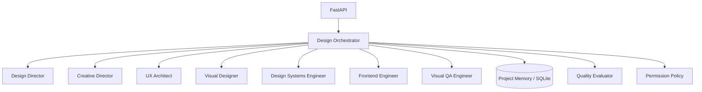

# Design Intelligence System

A modular, multi-agent design intelligence foundation. The initial release establishes a Design Director, six specialist roles, structured task handoffs, project-scoped SQLite memory, permission gates, a quality rubric, and a FastAPI interface.

> **Current capability boundary:** this release provides deterministic orchestration and agent contracts. It does not yet connect to an LLM provider, edit a codebase, launch a browser, capture screenshots, or claim visual verification. Those are explicit next milestones.

## Architecture



## Quick start

```bash
python -m venv .venv
source .venv/bin/activate  # Windows: .venv\\Scripts\\activate
pip install -e '.[dev]'
uvicorn app.main:app --reload
```

Open `http://127.0.0.1:8000/docs` for the API explorer.

## API

- `GET /health` — service health
- `GET /api/v1/agents` — registered roles
- `POST /api/v1/design/runs` — orchestrate a design brief
- `POST /api/v1/permissions/evaluate` — evaluate an action against autonomy policy

Example:

```bash
curl -X POST http://127.0.0.1:8000/api/v1/design/runs \\
  -H 'Content-Type: application/json' \\
  -d '{"brief":"Design a premium analytics dashboard","constraints":["WCAG AA","mobile first"]}'
```

## Development and tests

```bash
pip install -e '.[dev]'
pytest -q
```

## Autonomy and safety

Routine analysis and design planning are autonomous. Destructive, external, publishing, deployment, permission-changing, and merge actions require explicit approval. Secret exfiltration and disabling security controls are prohibited. The policy is a guardrail, not a substitute for authorization checks in future execution adapters.

## Roadmap

1. **Foundation (this release):** registry, orchestration, shared context, memory, permission policy, quality rubric, API.
2. **Provider adapters:** pluggable LLM clients, retries, token budgets, structured output validation, evaluation harness.
3. **Execution adapters:** repository workspace, patch proposals, sandboxed commands, browser automation.
4. **Visual feedback loop:** viewport screenshot capture, visual issue detection, prioritization, repair proposals, regression comparison.
5. **Learning and operations:** reference library, project design memory, run tracing, observability, user feedback.
